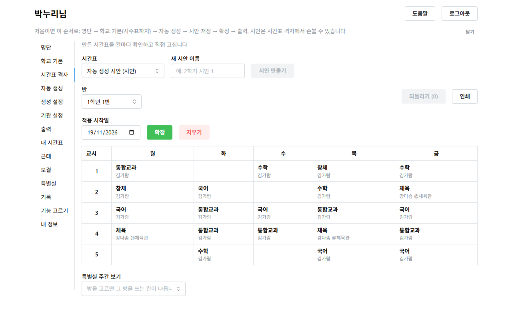
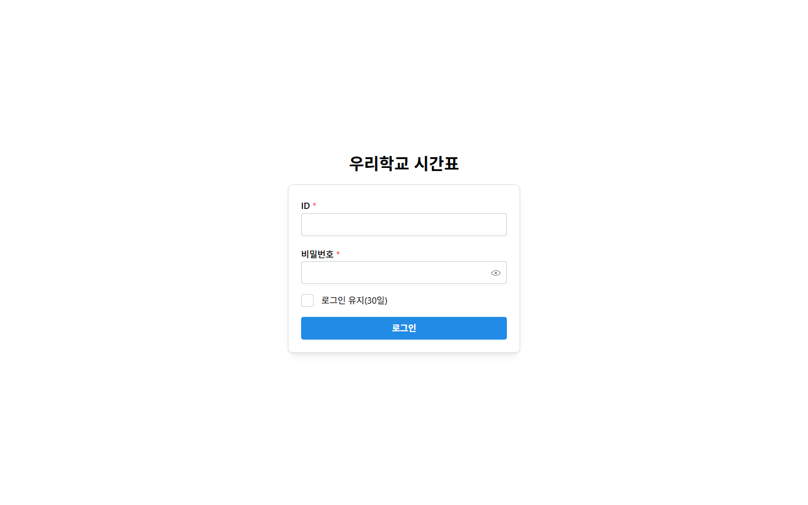
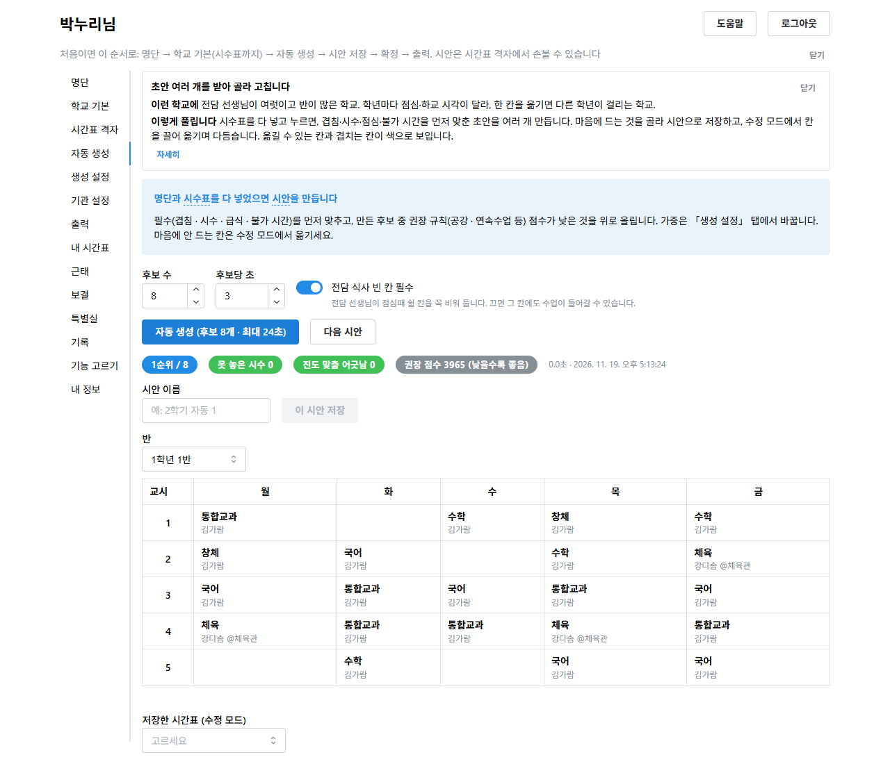
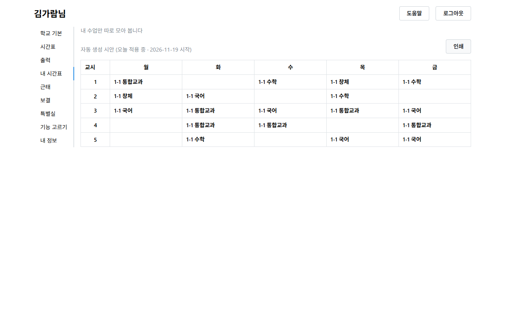
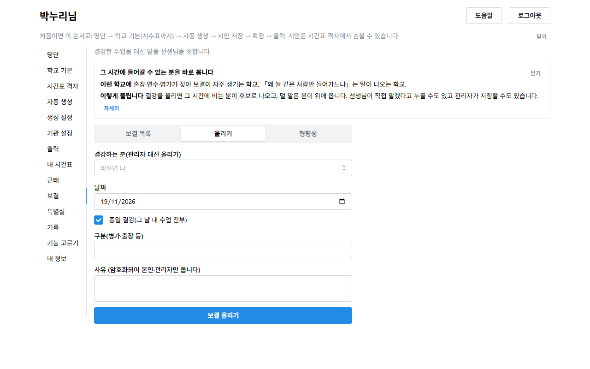
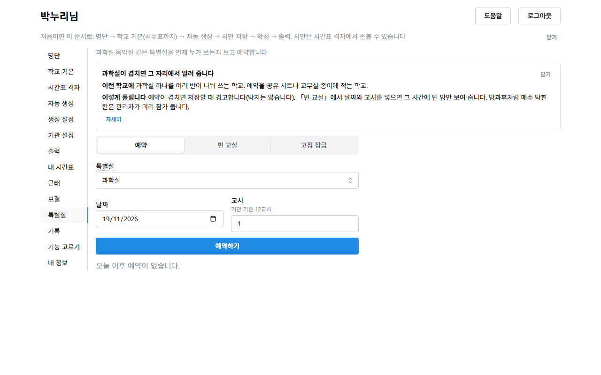
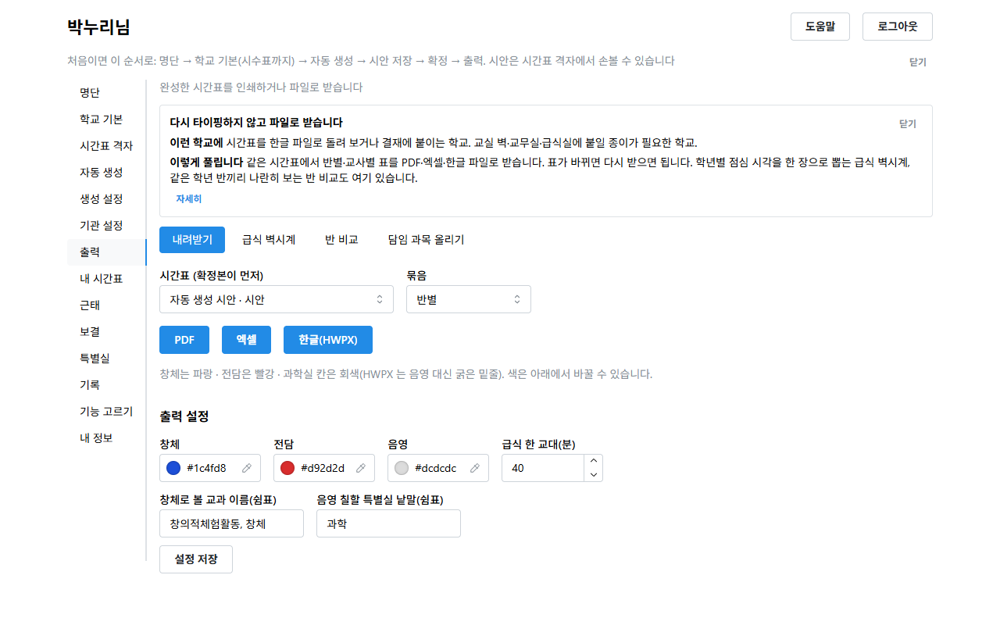
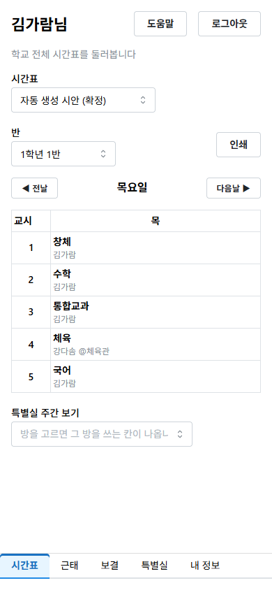

[한국어](README.md) | [English](README.en.md)

# Wee School Timetable

A self-hosted web app for building a school timetable and managing teacher, class and special-room schedules and substitutions in one place.

[](https://github.com/subnautica-kr/wee-school-timetable/actions/workflows/ci.yml)
[](LICENSE)




Note: the app's user interface and the docs under `docs/` are in Korean.

## Features

Every feature can be switched on or off. Start by filling the grid by hand, then turn features on as you get comfortable.

| Feature | What it does | Why it matters |
|---|---|---|
| Timetable grid | Fill cells per class, teacher or room; conflicts are flagged instantly | One edit affects several timetables, so you need them on one screen |
| Weekly-hours table | Enter weekly hours per teacher, subject and class; it counts what is missing | No more hunting for missing lessons by eye |
| Auto-generate | Builds several candidate timetables in the browser to pick from and tweak | Cuts the time spent starting from scratch |
| Pins and bans | Fix "this lesson in this slot" or forbid "this teacher in this slot" | Hard constraints are respected first |
| Rule strictness | Per rule: notice, warning, confirm, or off | Schools differ in how strict they want to be |
| Substitutions | Shows who can cover an absent teacher's lesson right away | The decision has to be made fast on the morning |
| Special rooms | Warns on double bookings and finds free rooms | Two classes never get the same room at once |
| Attendance | Enter support staff hours and get monthly totals | No manual month-end tallying |
| Export / import | Download PDF, Excel and HWPX; upload homeroom subject assignments | Removes retyping |
| Audit log | See who changed what and when | Find and undo mistakes |
| Accounts and roles | System admin, org admin, staff, read-only; membership in several orgs | Separate who may view from who may edit |

## Screenshots

<table>
<tr>
<td><br>Login</td>
<td><br>Auto-generate</td>
</tr>
<tr>
<td><br>Teacher timetable</td>
<td><br>Substitutions</td>
</tr>
<tr>
<td><br>Special rooms</td>
<td><br>Export</td>
</tr>
<tr>
<td><br>Mobile</td>
<td></td>
</tr>
</table>

## Quick start

### Docker

```bash
git clone https://github.com/subnautica-kr/wee-school-timetable.git
cd wee-school-timetable
cp .env.example .env     # fill DB_PASSWORD, SESSION_SECRET, DATA_KEY (see docs/install.md)
docker compose up -d --build
docker compose exec -e ADMIN_LOGIN_ID=admin -e ADMIN_NAME=관리자 app npm run seed:admin
```

### Plain install (Node 22 + PostgreSQL)

```bash
git clone https://github.com/subnautica-kr/wee-school-timetable.git
cd wee-school-timetable
npm ci && npm run build:web
cp .env.example .env     # fill DATABASE_URL, SESSION_SECRET, DATA_KEY and load it into your shell
npm run migrate
ADMIN_LOGIN_ID=admin ADMIN_NAME=관리자 npm run seed:admin
npm start
```

`seed:admin` prints a temporary password once. Open `http://localhost:3000`, sign in with ID `admin` (organization "상위 기관"), and change the password. For environment setup, updates and backups see the [install guide](docs/install.md).

### Try it on Render

[](https://render.com/deploy?repo=https://github.com/subnautica-kr/wee-school-timetable)

For a quick look only: the free plan sleeps and its database expires after 30 days. Use Docker or a plain install for real use.

## Documentation

- [Install](docs/install.md) — Docker, plain install, Render, updates and backups
- [Configuration](docs/configuration.md) — environment variables
- [Architecture](docs/architecture.md) — folders, request flow, data model
- [Security](docs/security.md) — sessions, CSRF, encryption, audit log
- [Development](docs/development.md) — dev setup and tests

## Tech stack

React + Vite + Mantine · Node 22 Express · PostgreSQL

## Contributing and security

- Contributing: [CONTRIBUTING.md](CONTRIBUTING.md) · Code of conduct: [CODE_OF_CONDUCT.md](CODE_OF_CONDUCT.md)
- Report security issues privately as described in [SECURITY.md](SECURITY.md), not in public issues.

## License

[MIT](LICENSE)
