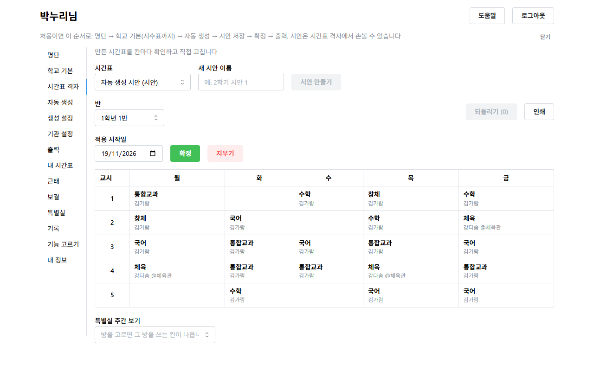
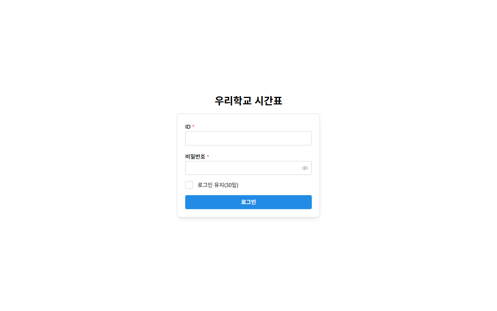
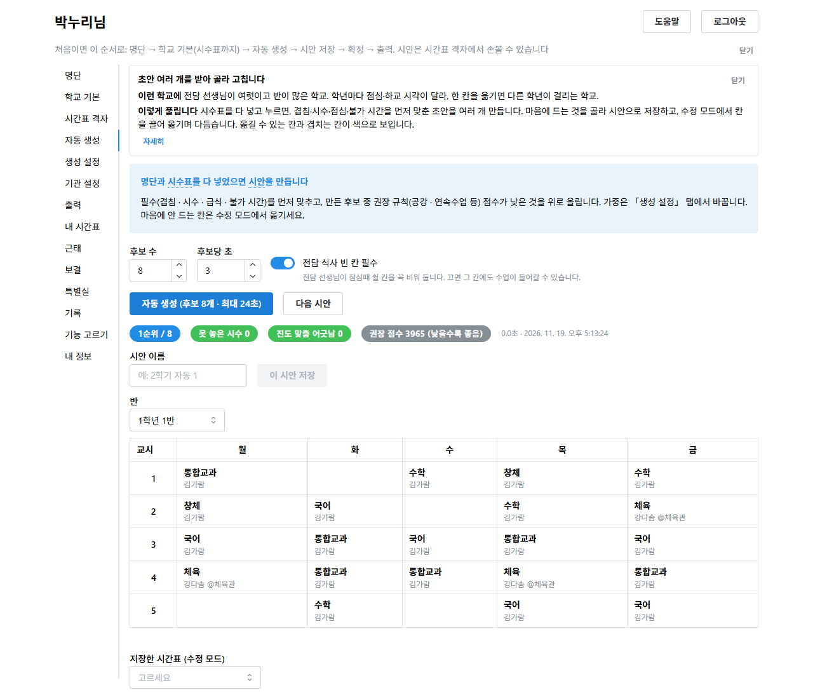
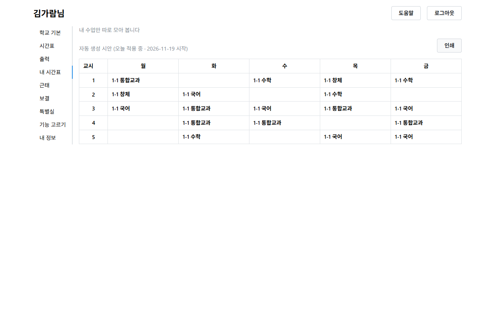
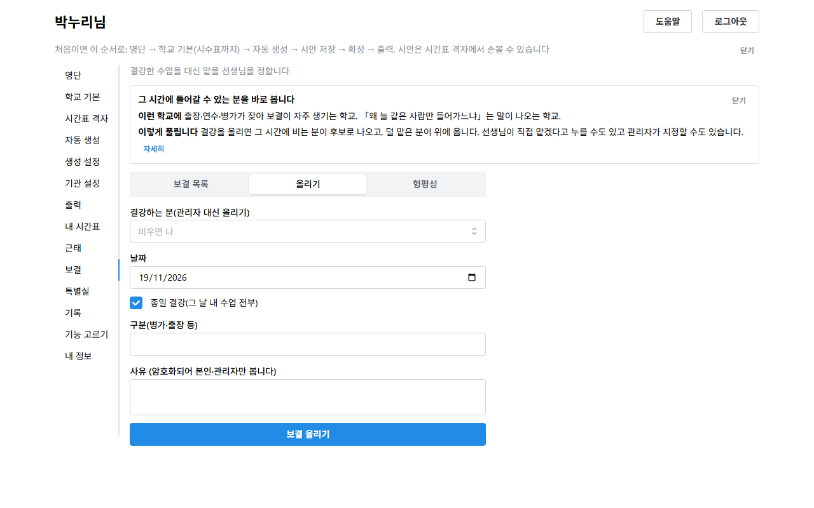
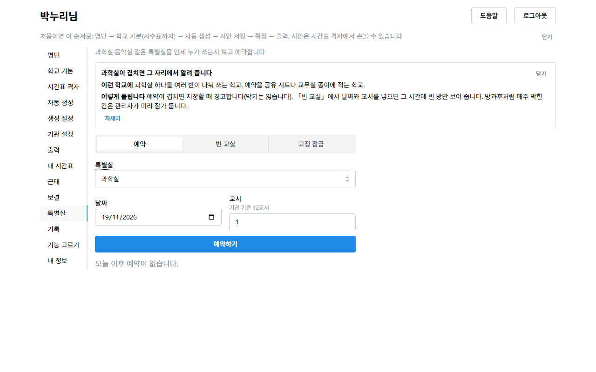
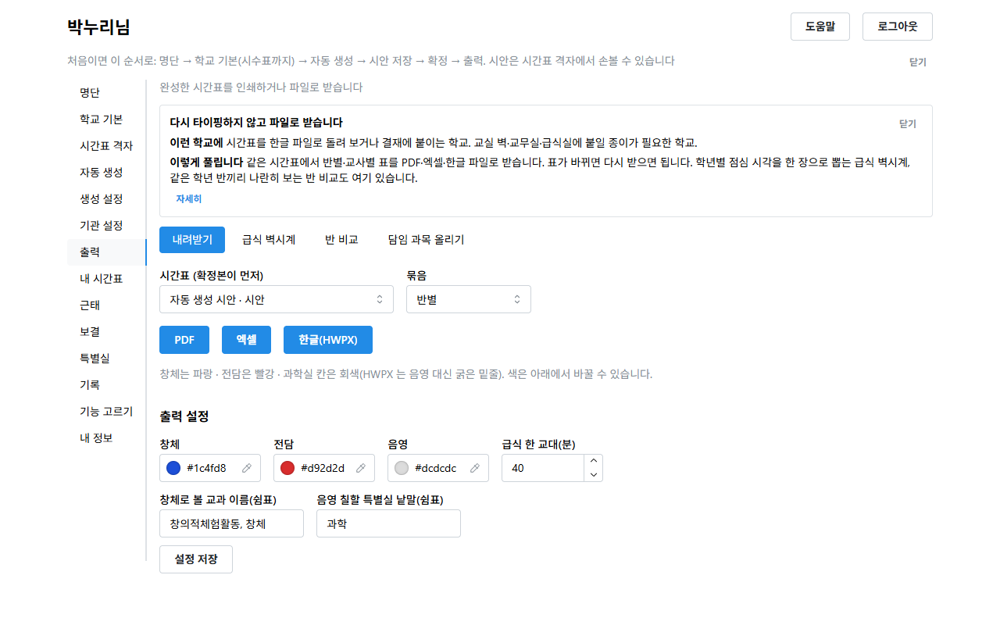
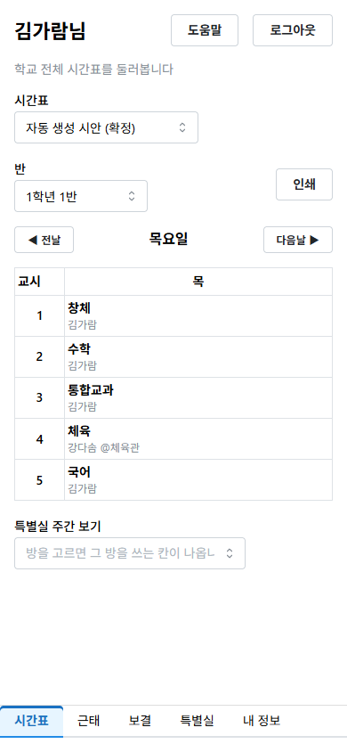

[한국어](README.md) | [English](README.en.md)

# 우리학교 시간표

학교 시간표를 짜고, 교사·반·특별실 시간표와 보결을 한 곳에서 다루는 자체 호스팅 웹앱입니다.

[](https://github.com/subnautica-kr/wee-school-timetable/actions/workflows/ci.yml)
[](LICENSE)




## 기능

필요한 기능만 켜서 쓸 수 있습니다. 처음에는 격자에 손으로 적는 것부터 시작하고, 익숙해지면 하나씩 켭니다.

| 기능 | 무엇을 하나 | 왜 필요한가 |
|---|---|---|
| 시간표 격자 | 반·교사·특별실 기준으로 칸을 채우고 겹침을 바로 표시 | 한 칸을 고치면 다른 시간표에도 영향이 가므로 한 화면에서 봐야 한다 |
| 시수표 | 교사·과목·반별 주당 시간을 적고 다 넣었는지 센다 | 빠진 시간을 눈으로 찾지 않아도 된다 |
| 자동 생성 | 후보 시간표 여러 개를 브라우저에서 만들어 골라 고친다 | 처음부터 짜는 시간을 줄인다 |
| 고정·금지 | 「이 수업은 이 칸」「이 교사는 이 칸 금지」를 생성에 반영 | 어길 수 없는 사정을 먼저 지킨다 |
| 규칙 수위 | 규칙마다 알림·경고·재확인·끔을 고른다 | 학교마다 엄격한 정도가 다르다 |
| 보결 | 결강 시간에 들어갈 수 있는 교사를 바로 보여 준다 | 당일 아침에 빨리 정해야 한다 |
| 특별실 | 예약이 겹치면 경고하고 빈 방을 찾아 준다 | 같은 시간에 한 방을 두 반이 쓰지 않게 한다 |
| 근태 | 보조인력 근무시간을 넣으면 달마다 합이 나온다 | 월말 집계를 손으로 하지 않는다 |
| 출력·가져오기 | PDF·엑셀·한글(hwpx) 내려받기, 담임 과목 배정 파일 올리기 | 옮겨 적는 일을 없앤다 |
| 기록 | 누가 언제 무엇을 바꿨는지 되짚는다 | 잘못 고친 것을 찾아 되돌린다 |
| 계정·권한 | 시스템관리자·기관관리자·교직원·보기만, 여러 기관 소속 | 볼 사람과 고칠 사람을 나눈다 |

## 화면

<table>
<tr>
<td><br>로그인</td>
<td><br>자동 생성</td>
</tr>
<tr>
<td><br>교사 시간표</td>
<td><br>보결</td>
</tr>
<tr>
<td><br>특별실</td>
<td><br>출력</td>
</tr>
<tr>
<td><br>모바일</td>
<td></td>
</tr>
</table>

## 빠른 시작

### 도커

```bash
git clone https://github.com/subnautica-kr/wee-school-timetable.git
cd wee-school-timetable
cp .env.example .env     # DB_PASSWORD · SESSION_SECRET · DATA_KEY 를 채운다(docs/install.md)
docker compose up -d --build
docker compose exec -e ADMIN_LOGIN_ID=admin -e ADMIN_NAME=관리자 app npm run seed:admin
```

### 그냥 설치 (Node 22 + PostgreSQL)

```bash
git clone https://github.com/subnautica-kr/wee-school-timetable.git
cd wee-school-timetable
npm ci && npm run build:web
cp .env.example .env     # DATABASE_URL · SESSION_SECRET · DATA_KEY 를 채우고 셸에 불러온다
npm run migrate
ADMIN_LOGIN_ID=admin ADMIN_NAME=관리자 npm run seed:admin
npm start
```

`seed:admin` 이 임시 비밀번호를 한 번 보여 줍니다. `http://localhost:3000` 에서 기관 「상위 기관」, ID `admin` 으로 로그인한 뒤 비밀번호를 바꾸세요. 환경변수 준비와 업데이트·백업은 [설치 안내](docs/install.md)를 보세요.

### Render 로 띄워 보기

[](https://render.com/deploy?repo=https://github.com/subnautica-kr/wee-school-timetable)

맛보기용입니다. 무료 플랜은 잠들고 DB 가 30일 뒤 만료되므로 실제 운영은 도커나 직접 설치를 권합니다.

## 문서

- [설치](docs/install.md) — 도커 · 직접 설치 · Render · 업데이트와 백업
- [설정](docs/configuration.md) — 환경변수
- [구조](docs/architecture.md) — 폴더, 요청 흐름, 데이터 모델
- [보안](docs/security.md) — 세션·CSRF·암호화·감사 기록
- [개발](docs/development.md) — 개발 환경과 시험

## 기술 스택

React + Vite + Mantine · Node 22 Express · PostgreSQL

## 기여와 보안 신고

- 기여: [CONTRIBUTING.md](CONTRIBUTING.md) · 행동 강령: [CODE_OF_CONDUCT.md](CODE_OF_CONDUCT.md)
- 보안 문제는 공개 이슈 대신 [SECURITY.md](SECURITY.md) 의 방법으로 알려 주세요.

## 라이선스

[MIT](LICENSE)
