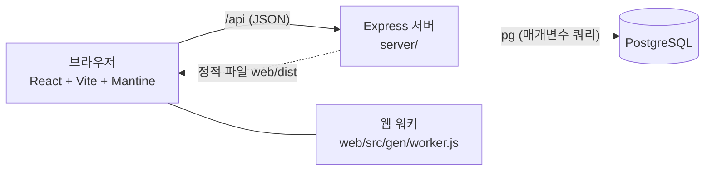
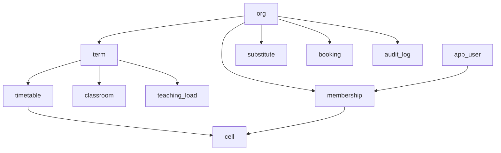

# 구조

우리학교 시간표(Wee School Timetable)는 학교 시간표를 편성하고 운영(보결·특별실 예약·근태)하는 웹앱이다. 서버는 Express 하나, 화면은 React 단일 페이지, 데이터는 PostgreSQL 한 곳에 둔다. 시간표 자동 생성은 서버가 아니라 브라우저의 웹 워커에서 돈다.

## 전체 그림

- 서버는 `/api` 아래 JSON API 와 빌드된 화면 파일(`web/dist`)을 함께 낸다(`server/app.js`).
- 세션은 `connect-pg-simple` 로 PostgreSQL 의 `session` 표에 둔다(`server/app.js`, `server/schema.sql`).
- 생성 워커는 재료(반·교사·시수·고정 칸)를 받아 후보를 만들어 돌려줄 뿐이며, 서버는 재료를 내주고 고른 시안을 저장·확정한다(`server/routes/generate.js` 머리 주석).

## 폴더 지도

| 폴더 | 내용 |
|---|---|
| `server/` | 앱 조립(`app.js`)·진입점(`index.js`)·DB 연결(`db.js`)·마이그레이션(`migrate.js`)·권한 표(`permissions.js`)·로그인 확인(`guard.js`)·비밀번호 규칙(`passwords.js`)·감사 기록(`audit.js`)·암호화(`seal.js`) |
| `server/routes/` | 기능별 라우터 한 파일씩(`auth.js`, `school.js`, `timetables.js`, `generate.js`, `substitute.js`, `booking.js`, `attendance.js`, `export.js` 등). `org.js` 머리 주석이 새 경로를 만드는 본보기다 |
| `server/migrations/` | `001`~`010` 번호 순으로 적용하는 SQL. 모두 여러 번 돌려도 안전한 꼴(`IF NOT EXISTS` 등)이다 |
| `server/export/` | 내려받기(xlsx·pdf·hwpx)와 가져오기 |
| `server/presets/` | 기본 교과 목록(`subjects.json`) |
| `shared/` | 서버와 화면이 같이 쓰는 순수 코드(겹침 판정 `overlap.js`, 기능 목록 `features.js`, 확정 `ttConfirm.js` 등) |
| `web/src/<기능>/` | 화면. `admin`(명단·감사 기록·비밀번호) · `school`(학교 기본) · `grid`(시간표 격자) · `generate`(자동 생성 화면) · `gen`(생성기 본체) · `rules`(규칙 설정) · `operations`(보결·특별실) · `attendance`(근태) · `export`(출력) · `settings`(기관 설정) |
| `scripts/` | 관리자 계정·견본 자료 심기, 생성 시간 재기, 부하 시험, 배포 묶음(`ship.sh`, `scripts/ship/`) |
| `test/` | `node --test` 시험. 대부분 DB 가 필요하다 |

## 요청 흐름: 로그인에서 라우트까지

1. `POST /api/auth/login` — 입력을 zod 로 검사하고, 아이디로 사람과 소속(`membership`)을 찾아 argon2 로 비밀번호를 확인한다(`server/routes/auth.js`). 소속이 여럿이면 `pending` 상태로 두고 `/api/auth/pick-org` 에서 기관을 고르게 한다.
2. 성공하면 세션 ID 를 새로 발급(`regenerate`)하고 `userId`·`orgId`·`role`·`csrf` 를 세션에 넣는다.
3. 이후 상태를 바꾸는 요청(GET·HEAD·OPTIONS 가 아닌 것)은 `X-CSRF-Token` 헤더가 세션의 토큰과 같아야 한다(`server/app.js`). 화면은 `web/src/api.js` 가 이 헤더를 붙인다.
4. 기관 안 경로(`/api/orgs/:orgId/...`)는 라우트마다 `requireOrgAction(동작)` 을 건다(`server/guard.js`). 세션의 기관이 URL 의 기관과 같은가, 세션의 역할이 그 동작을 할 수 있는가(`server/permissions.js`)를 보고, 어긋나면 그 기관의 존재를 알리지 않도록 404 를 돌려준다. 비밀번호 강제 변경 상태면 403 이다.
5. 라우트 안의 쿼리는 URL 이 아니라 세션에서 온 `req.orgId` 를 쓰고, 기관 자료 쿼리에 `org_id` 조건과 `deleted_at IS NULL` 을 건다(`server/routes/org.js` 머리 주석).

## 권한 단위

- 기관(`org`): 학교 또는 상위 기관. `kind` 는 `상위 기관`·`초`·`중`(`server/schema.sql`).
- 사람(`app_user`)은 기관에 매이지 않고, 소속(`membership`)이 사람과 기관을 잇는다. 한 사람이 여러 기관에 소속될 수 있고(겸임) `UNIQUE (user_id, org_id)` 이다.
- 역할은 소속마다 하나: `시스템관리자`·`기관관리자`·`교직원`·`보기만`. 역할별로 할 수 있는 동작은 `server/permissions.js` 의 `PERMISSIONS` 표 한 곳에 있다.
- 시스템 관리자는 기관 관리 동작(`org.manage`)만 갖고 기관 안 자료 동작은 갖지 않는다. 기관 안에서는 기관 관리자가 전부, 교직원이 보기·내 보결·내 예약·내 근태, 보기만은 보기만 할 수 있다.
- 교사는 별도 표 없이 `membership` 한 줄이다. 시수표·시간표 칸·보결의 교사 칸은 `membership_id` 를 가리킨다.
- 학기(`term`)는 `진행`/`보관` 상태가 있고, 보관 학기의 시간표·시수·고정 핀·반은 고치기를 409 로 거부한다(`server/app.js`).

## 데이터 모델

정본은 `server/schema.sql` 과 `server/migrations/*.sql` 이다. 지우기는 대개 `deleted_at` 표시 삭제이고, DB 가 막는 것은 「같은 것이 둘」(유일 제약)뿐이다. 교사·특별실 겹침은 DB 가 아니라 규칙 위반 목록으로 알린다(`server/schema.sql` 머리 주석).

| 표 | 뜻 · 주요 관계 |
|---|---|
| `org` | 기관. 교시 설정(`period_config`)·규칙 수위(`rule_levels`)·`config`·`soft_weights`·`small_school`·`export_settings` 를 JSONB 로 가진다 |
| `app_user` | 로그인 계정. 비밀번호 해시·실패 횟수·잠금 시각 |
| `membership` | 소속 한 줄 = 명단 한 줄. `org`·`app_user` 를 잇고 역할·직무·티어를 가진다 |
| `session` | 로그인 세션(connect-pg-simple 이 쓰는 표) |
| `term` | 학기. `org` 에 딸린다 |
| `classroom` · `subject` · `special_room` | 반(학기별) · 교과 · 특별실. 담임은 `membership` 을 가리킨다 |
| `teaching_load` | 시수표 한 줄. 학기·교사·교과·반(없으면 전체)·주당 시수·특별실 |
| `pin` | 교사·반·특별실의 고정/금지 칸(요일·교시) |
| `timetable` | 시간표 시안/확정. `term` 에 딸리고 적용 시작일·위반 목록·생성 정보를 가진다 |
| `cell` | 시간표 칸. 시안·반·요일·교시마다 하나(유일 제약), 교과·교사·특별실을 가리킨다 |
| `substitute` | 보결. 결강 교사·날짜·교시·상태·맡은 사람. 사유는 암호화 칸 `reason_enc` |
| `booking` · `room_lock` | 특별실 예약 · 특별실 고정 칸 잠금 |
| `attendance` · `attendance_allowed` · `month_close` | 근태 · 사람별 허용 교과 · 월 마감 |
| `audit_log` | 감사 기록(누가·무엇을·전/후 값) |

관계의 큰 줄기:

## 시간표 생성기

생성기는 `web/src/gen/` 의 순수 함수 묶음이고 서버로 보내지 않는다(`web/src/gen/core.js` 머리 주석). 화면은 `web/src/generate/AutoGen.jsx` 이다.

| 파일 | 역할 |
|---|---|
| `web/src/gen/worker.js` | 웹 워커 진입점. 재료를 받아 `generate` 를 돌리고 진행·결과를 메시지로 돌려준다 |
| `web/src/gen/core.js` | 핵심. `prepare`(재료 정리) → `solve`(후보 하나 풀기) → `generate`(여러 후보를 만들어 줄 세우기) |
| `web/src/gen/soft.js` | 권장 규칙. 위반 목록을 점수로 환산한다 |
| `web/src/gen/soft-adapter.js` | 생성 재료를 `soft.js` 의 상태 꼴로 바꿔 점수 함수를 만든다 |
| `web/src/gen/store.js` | 중간 결과를 IndexedDB 에 저장해 탭을 닫아도 이어 쓰게 한다 |
| `shared/overlap.js` | 칸 겹침 판정. 서버의 `server/violations.js` 와 공용(`web/src/gen/overlap.js` 가 다시 내보냄) |

### 제약(필수 규칙)

`core.js` 의 `HARD_RULES` 에 12개가 나열되어 있다: 한 반 한 시각 한 과목, 한 교사·한 특별실 한 시각 한 반, 주당 시수 채우기, 학년 교시 범위, 급식 칸 비우기, 전담 교사 식사용 빈 칸, 교사·특별실 불가 시간, 고정·금지 칸 존중, 연강은 같은 날 붙여 점심을 넘지 않게, 진도 맞춤. 충돌은 교시 번호가 아니라 시각 칸(`clockOf`)으로 판정한다. 학년마다 점심 위치가 달라 같은 「N교시」가 다른 시각이기 때문이다. 기관이 끈 필수 규칙은 `input.hardOff` 로 들어온다(`prepare`).

업무 규칙을 막지 않는다. 못 놓은 수업과 남은 위반은 결과에 목록으로 담긴다.

### 탐색

- `prepare` 가 수업(lesson)을 만들고 반·교사·특별실의 점유 배열과 막힌 칸을 준비한다.
- `solve` 는 고정 칸을 먼저 놓고, 남은 수업을 전략별 순서로 놓는다. 순서는 `strategy % 4` 로 갈린다(어려운 것 먼저 · 어려운 순에 무작위를 섞기 · 특별실 먼저 · 무작위). 후보당 시간 제한(`deadline`)이 있고, 씨앗(`seed`)을 바꾸면 결과가 달라진다.
- `generate` 는 전략·씨앗을 바꿔 K 개(기본 8, `AutoGen.jsx` 의 `K`)를 만들고, 후보당 기본 3000ms(`PER_MS`)를 쓴다. 후보는 못 놓은 시수 → 진도 위반 → 권장 점수 순으로 오름차순 정렬한다. 화면에서 후보 수(1~40)와 후보당 시간(0.5~60초)을 바꿀 수 있다(`clampOpt`).

### 점수

`soft.js` 의 `SOFT_RULES` 는 권장 규칙을 묶음(`거의필수`·`중요`·`선호`)으로 나눈다. 점수는 묶음 가중(`DEFAULT_WEIGHTS.bands`: 100·20·3) × 교사 티어 배수이고, 낮을수록 좋다. 회피 선호는 티어별 배수가 따로 있다(`avoidanceTierMult`). 기관 설정 `org.soft_weights` 가 기본 가중을 덮는다.

### 손대는 곳

| 하고 싶은 일 | 고칠 곳 |
|---|---|
| 필수 규칙 추가·변경 | `core.js` 의 `HARD_RULES` 와 `prepare`·`solve` 의 점유·금지 처리 |
| 놓는 순서 전략 추가 | `core.js` `solve` 의 `strategy % 4` 분기 |
| 권장 규칙 추가 | `soft.js` 의 `SOFT_RULES` 와 점수 계산, 입력 연결은 `soft-adapter.js` |
| 가중치 기본값 | `soft.js` 의 `DEFAULT_WEIGHTS` |
| 후보 수·시간 기본값 | `AutoGen.jsx` 의 `K`·`PER_MS` |
| 서버 쪽 위반 표시 | `server/violations.js`, 수위는 `server/rules.js` |

성능은 `node scripts/bench-gen.js` 로 잴 수 있다(가짜 51반·전담 11 자료로 `core.js` 를 node 에서 돌린다).
